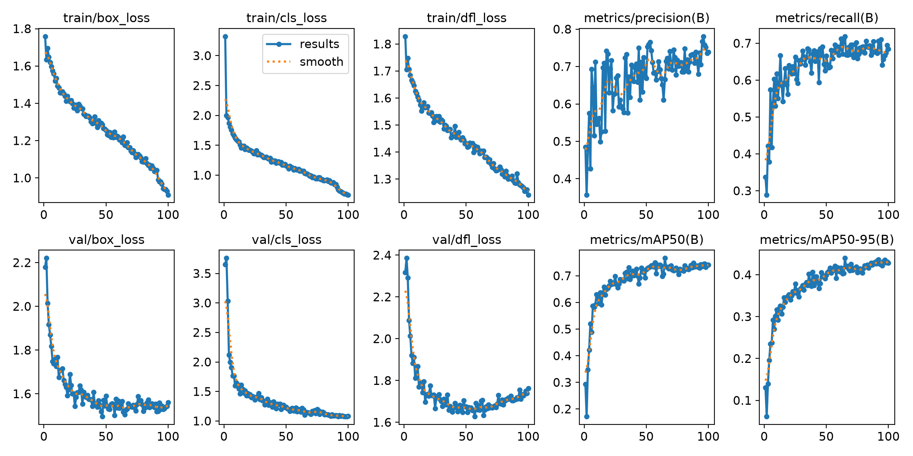
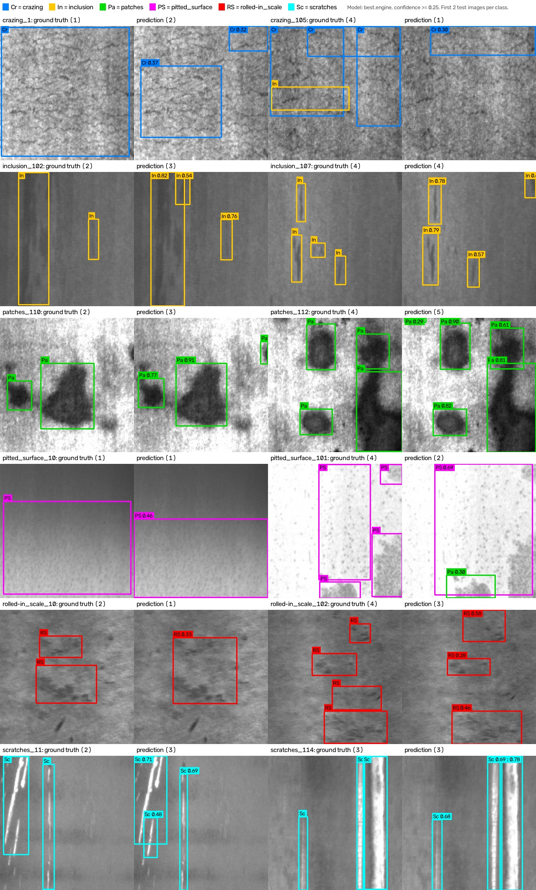

# Steel surface defect detection: YOLOv8s on NEU-DET, exported to ONNX and TensorRT

A short learning project, done on 16–17 November 2026, to get hands-on experience with the full path
from fine-tuning an object detector to deploying it with ONNX Runtime and TensorRT on an NVIDIA GPU.

It is deliberately small: one dataset of 1,800 images, **one training run, one data split, and no
hyperparameter search**. Every number in this README comes from the scripts in this repository, run on
the machine described under [Environment](#environment). Results files are in [`results/`](results/).

## Summary

| | |
|---|---|
| Dataset | NEU-DET (Northeastern University), 1,800 grayscale 200×200 images, 6 defect classes, 4,189 boxes |
| Split | Stratified by class: 1,260 train / 270 val / 270 test (210 / 45 / 45 per class), seed 0 |
| Model | YOLOv8s (11.1 M parameters, 28.4 GFLOPs at 640 px), fine-tuned from COCO weights, 100 epochs |
| Test accuracy | **mAP50 0.738, mAP50-95 0.411** (identical within 0.001 for PyTorch, ONNX Runtime and TensorRT) |
| Model latency, batch 1 | PyTorch 3.0–3.2 ms · ONNX Runtime 2.5–2.9 ms · **TensorRT FP16 0.63–0.66 ms** (median, two runs) |
| Speed-up | TensorRT FP16 is **4.5–5.0×** faster than PyTorch for the model alone, **2.4×** per image end to end |

## Results

### Accuracy and latency by format (test split, 640×640, batch 1)

From [`results/benchmark.md`](results/benchmark.md) (second run). Forward latency is the model alone:
50 warm-up passes, then the median and 95th percentile of 500 timed passes with a CUDA synchronize after
each.

| Format | File (MB) | mAP50 | mAP50-95 | Forward median (ms) | Forward p95 (ms) | Speed-up vs PyTorch FP32 |
|---|---|---|---|---|---|---|
| PyTorch FP32 ¹ | 21.5 | 0.738 | 0.411 | 3.01 | 3.83 | 1.00× |
| PyTorch FP16 | 21.5 | 0.738 | 0.411 | 3.36 | 4.58 | 0.89× |
| ONNX Runtime FP32 (CUDA EP) | 42.7 | 0.738 | 0.410 | 2.93 | 3.53 | 1.03× |
| TensorRT 10 FP16 | 24.1 | 0.738 | 0.411 | 0.66 | 0.71 | 4.52× |

¹ "FP32" means FP32 storage. PyTorch 2.15 runs FP32 convolutions in TF32 on tensor cores by default
(`torch.backends.cudnn.conv.fp32_precision == "tf32"`), so this is not a strict-FP32 baseline.

**Latency varies between runs.** The forward-latency loop always uses a fixed 640×640 input, so the first
benchmark run ([`results/run1_default_val/`](results/run1_default_val/)) is a second valid latency
measurement:

| Format | Run 1 median / p95 (ms) | Run 2 median / p95 (ms) | Speed-up range |
|---|---|---|---|
| PyTorch FP32 | 3.20 / 4.14 | 3.01 / 3.83 | 1× |
| PyTorch FP16 | 3.19 / 4.03 | 3.36 / 4.58 | 0.89–1.00× |
| ONNX Runtime FP32 | 2.48 / 2.92 | 2.93 / 3.53 | 1.03–1.29× |
| TensorRT FP16 | 0.63 / 0.67 | 0.66 / 0.71 | 4.52–5.04× |

What I take from this:

- **FP16 did not change accuracy.** PyTorch FP16 matches FP32, and TensorRT FP16 matches ONNX Runtime FP32,
  to within 0.001 mAP.
- **FP16 did not make PyTorch faster at batch 1**, while TensorRT ran the same network in about 0.65 ms.
  So most of PyTorch's ~3 ms is not arithmetic. My working explanation is per-operation overhead: eager
  PyTorch launches each layer's GPU kernels one at a time from Python, and faster maths does not shorten
  that. TensorRT fuses layers into far fewer kernels and launches the whole network with one call. I have
  not profiled this, so it is a hypothesis (see [Next steps](#next-steps)).
- **ONNX Runtime and PyTorch are within run-to-run noise of each other** (1.03× in one run, 1.29× in the
  other). Only the TensorRT gain is clearly larger than the noise.
- **TensorRT is also the most consistent** (p95 within 0.05 ms of the median). The runtimes that do more
  CPU work per image vary more; the GPU is shared with the Windows desktop under WSL2.

### End to end per image: Amdahl's law

Ultralytics' validation times preprocessing, inference and postprocessing (NMS) separately
(run 2, ms per image, averaged over the 270 test images):

| Format | Preprocess | Inference | Postprocess (NMS) | Total |
|---|---|---|---|---|
| PyTorch FP32 | 0.45 | 3.48 | 0.67 | 4.60 |
| TensorRT FP16 | 0.47 | 0.70 | 0.75 | 1.92 |

TensorRT makes the model about 4.5× faster but the whole pipeline only **2.4×** faster: with TensorRT,
preprocessing and NMS are about 64% of the time per image. Further speed-ups would have to come from
there (NMS inside the engine, GPU preprocessing), not from a faster network.

### Training

[`assets/training_curves.png`](assets/training_curves.png) shows the per-epoch losses and validation
metrics. `runs/` is not committed; the values below are copied from `runs/yolov8s_640/results.csv`.



- 100 epochs took 0.186 h (about 11 minutes) on the RTX 4070 Ti.
- `optimizer=auto` chose AdamW with a learning rate of 0.001 (Ultralytics uses AdamW when a run has fewer
  than 10,000 optimizer steps; this one had 2,000). `results.csv` confirms the learning rate peaked at
  0.000976 after warm-up.
- Training losses fell throughout: box 1.759 → 0.910, cls 3.322 → 0.673, dfl 1.828 → 1.242.
- Validation box loss was lowest at epoch 47 (1.496) and ended at 1.561; validation DFL loss was lowest at
  epoch 57 (1.628) and ended at 1.762. Validation mAP50-95 stayed between 0.39 and 0.44 from epoch 50
  onwards. **This is mild overfitting in box localisation over the second half of training**; more epochs
  would not have helped.
- `best.pt` is the epoch with the highest validation mAP50-95 (epoch 65: mAP50 0.766, mAP50-95 0.440).
  Those validation numbers were measured on a 672×672 padded input (see
  [What went wrong](#what-went-wrong-and-how-i-fixed-it)), so they are not directly comparable to the test
  numbers above.

### Per-class analysis

| Class | Test boxes | AP50 | AP50-95 | Found at conf 0.25 ² | Missed at conf 0.25 ² |
|---|---|---|---|---|---|
| patches | 135 | 0.922 | 0.600 | 90% | 10% |
| scratches | 87 | 0.919 | 0.529 | 91% | 9% |
| inclusion | 139 | 0.788 | 0.416 | 80% | 20% |
| pitted_surface | 64 | 0.788 | 0.481 | 80% (+2% predicted as patches) | 19% |
| rolled-in_scale | 96 | 0.655 | 0.312 | 66% | 34% |
| crazing | 105 | **0.355** | **0.125** | **30%** | **70%** |

² From [`assets/confusion_matrix_conf025.png`](assets/confusion_matrix_conf025.png): a ground-truth box
counts as found if a prediction with confidence > 0.25 overlaps it with IoU > 0.5 (TensorRT engine,
test split). AP columns are from the PyTorch FP32 row of the benchmark; all formats agree within 0.006.



*The first two test images of each class by file name (not hand-picked). Left: ground truth. Right: TensorRT
FP16 predictions at confidence ≥ 0.25.*

- **Crazing and rolled-in scale are the weak classes.** At the single confidence threshold that maximises
  F1 over all classes (0.262, F1 0.67, from [`assets/f1_curve_test.png`](assets/f1_curve_test.png)),
  crazing has precision 0.47 and recall 0.27, and rolled-in scale has precision 0.55 and recall 0.65
  ([`results/benchmark.json`](results/benchmark.json)). Crazing's own F1 curve peaks at about 0.44 near a
  confidence of about 0.2 (read off the plot), so one global threshold suits it badly. In deployment I
  would set thresholds per class.
- **The model rarely confuses classes.** The largest off-diagonal entry in the confusion matrix is 2%
  (pitted surface predicted as patches, a pair that also co-occurs in the labels). Errors are almost all
  "missed" or "false alarm", not "wrong class".
- **The prediction images suggest the weak classes fail on box granularity.** In `crazing_1` the label is
  one box over almost the whole image and the model predicts two smaller boxes; in `rolled-in_scale_10`
  and `rolled-in_scale_102`, and in `pitted_surface_101`, it merges several labelled regions into one box.
  The model's boxes often cover the defective area, but they do not line up with how the annotator split
  it, so at IoU 0.5 they count as both a miss and a false alarm. Crazing's steep drop from AP50 (0.355) to
  AP50-95 (0.125) fits the same picture. This is based on 12 images and is a hypothesis, not a measurement.
- **Box-count imbalance is not the main driver.** Pitted surface has the fewest boxes (432 in the whole
  dataset, against 1,011 for inclusion) but is mid-table. Every class has exactly 300 images.

## What went wrong and how I fixed it

1. **ONNX Runtime silently fell back to the CPU.** Creating a session with the CUDA execution provider
   printed `libcurand.so.10: cannot open shared object file` and the session ran on
   `CPUExecutionProvider` only. Cause: CUDA 13 pip wheels install their libraries in
   `site-packages/nvidia/cu13/lib`, which is not on the loader path. `import torch` loads the CUDA
   libraries PyTorch needs, but PyTorch does not use cuRAND. Fix: call `onnxruntime.preload_dlls()` before
   creating the session (Ultralytics already does this in its ONNX backend). `scripts/check_env.py` now
   reports the providers a real session gets, and the benchmark records them. Lesson: "provider available"
   is not "provider used".

2. **Exported models scored 0.037 mAP50 lower than PyTorch, but the export was fine.** The first benchmark
   ([`results/run1_default_val/`](results/run1_default_val/)) gave PyTorch mAP50 0.775 / mAP50-95 0.450
   against 0.738 / 0.410 for ONNX Runtime and TensorRT. ONNX FP32 and TensorRT FP16 matched each other,
   which pointed away from precision. Cause: `model.val()` defaults to `rect=True`, and validation pads
   rectangular batches with `pad=0.5`, so a `.pt` model saw a 672×672 canvas (the 640 px image plus a
   16 px grey border), while fixed-shape ONNX and TensorRT models are forced to `rect=False` and see
   exactly 640×640. With `rect=False` for every format, all four agree. This is train/serve skew: the
   model being measured received different preprocessing from the model being deployed. Side finding,
   not explained yet: the padded 672 input scored higher.

3. **The default confusion matrix was misleading.** Ultralytics validates at confidence 0.001 so the
   precision–recall curve covers every threshold, and it builds the confusion matrix at that same 0.001.
   Almost every ground-truth box then matches some low-confidence box (it showed 100% of crazing found).
   `scripts/make_figures.py` re-plots it at confidence 0.25; the mAP printed by that extra run is
   truncated and is not reported anywhere.

4. **TensorRT 11 vs 10.** The newest CUDA 13 TensorRT (11.4) removed the FP16 builder flag; Ultralytics
   then converts the ONNX graph with NVIDIA ModelOpt first, an extra dependency pinned to the exact
   PyTorch version. With a one-hour budget for TensorRT I pinned `tensorrt-cu13<11` (10.16.1.11), which
   builds FP16 with the builder flag. The build worked first time (157 s).

5. **Smaller things.** Ultralytics 8.4 replaced `half=True` with `quantize=16`; a relative `path:` in
   `data.yaml` that does not exist from the current directory is silently looked up under Ultralytics'
   `DATASETS_DIR`, so the data script writes an absolute path; 174 of the NEU-DET XML files have a
   `<filename>` without `.jpg`, so images and labels are paired by file name instead.

## Limitations

- **Small data, one run.** 1,800 images, one split, one seed, no hyperparameter search, no error bars.
  The test set has 270 images and 64–139 boxes per class, so per-class AP differences of a few points may
  be noise.
- **No defect-free images.** Every NEU-DET image contains at least one defect, so false alarms on clean
  steel, which dominate the cost on a real line, cannot be measured here.
- **Ambiguous labels for texture defects.** For crazing and rolled-in scale, where one defect starts and
  ends is a judgement call; box mAP partly measures agreement with the annotator's style.
- **Latency is from one machine.** RTX 4070 Ti under WSL2 with the GPU shared with the desktop, two
  benchmark runs, batch 1 only, Python pre/post-processing. The TensorRT engine is only valid on this GPU
  model with TensorRT 10.16.
- **Input size.** The 200×200 images are upscaled 3.2× to 640×640 (Ultralytics default) and the grey
  image is copied into 3 channels to match the COCO-pretrained first layer. I did not test other sizes.
- **Weight decay barely did anything.** With AdamW at lr 0.001, the default `weight_decay=0.0005`
  (tuned for SGD) shrinks weights by at most about 0.1% over the run.
- I did not check ONNX Runtime's TF32 setting, so its "FP32" row may also use TF32 convolutions.

## Next steps

- **Measure what the line needs.** Add image-level "defect flagged / not flagged" metrics and per-class
  thresholds, and test on defect-free steel.
- **672 vs 640 input.** Export at 672 to find out whether the padded border's higher mAP holds up.
- **Smaller input for latency.** Train at 224 or 256 px (closer to the native 200 px) and compare mAP
  against latency.
- **Pre/post-processing.** NMS inside the engine (Ultralytics `nms=True` export) and GPU preprocessing.
- **Test the overhead hypothesis.** Profile PyTorch, try larger batches, CUDA Graphs or `torch.compile`,
  and a strict-FP32 baseline.
- **INT8 TensorRT** with calibration on training images, and TensorRT 11 with ModelOpt.
- **Edge hardware.** Rebuild and benchmark the engine on a Jetson.
- **More reliable numbers.** Several seeds or cross-validation; try larger AdamW weight decay, vertical
  flips (plausible for steel), and segmentation masks for the texture classes.

## Reproduce

```bash
python3 -m venv .venv && source .venv/bin/activate
pip install -r requirements.txt
python scripts/check_env.py            # GPU, CUDA, ONNX Runtime provider, TensorRT

mkdir -p data/raw && cd data/raw
gdown 1qrdZlaDi272eA79b0uCwwqPrm2Q_WI3k   # NEU-DET.zip from the authors' Google Drive link
sha256sum NEU-DET.zip                    # expect cf04bb0b05d364f23e05031b191b20b908a0e5eb11466df74ee7fba98ec835d5
python -m zipfile -e NEU-DET.zip .
cd ../..

python scripts/prepare_dataset.py      # VOC XML -> YOLO labels, 70/15/15 split (splits/*.txt)
python scripts/train.py                # runs/yolov8s_640/
python scripts/export.py               # best.engine (TensorRT FP16), best.onnx (FP32)
python scripts/benchmark.py            # results/benchmark.{json,md}
python scripts/make_figures.py         # assets/
```

The exact split used here is committed in [`splits/`](splits/), so `prepare_dataset.py` with the default
seed reproduces it. Training on a GPU is not bit-for-bit deterministic, so retrained numbers may differ
slightly.

## Repository layout

```
scripts/check_env.py        environment check (versions, GPU kernel, ORT provider, TensorRT builder)
scripts/prepare_dataset.py  NEU-DET VOC XML -> YOLO format, stratified split, data checks
scripts/train.py            fine-tune yolov8s.pt with Ultralytics defaults
scripts/export.py           ONNX (FP32) and TensorRT (FP16) export
scripts/benchmark.py        test-split mAP, per-class AP and latency for all formats
scripts/make_figures.py     README figures
splits/                     train / val / test file lists
results/                    benchmark outputs (second run, plus the first run in run1_default_val/)
assets/                     figures used in this README
```

## Environment

Windows 11 with WSL2 (Ubuntu 24.04.5 LTS), Intel Core i7-13700K, NVIDIA GeForce RTX 4070 Ti (12 GB,
compute capability 8.9), driver 620.70.03 (CUDA 13.5). Python 3.12.3, PyTorch 2.15.0+cu132 (CUDA 13.2,
cuDNN 9.26), Ultralytics 8.4.215, ONNX 1.23.2, onnxslim 0.1.99, ONNX Runtime GPU 1.32.0,
TensorRT 10.16.1.11. Full pins in [`requirements.txt`](requirements.txt).

## Data, citation and licences

**Dataset.** NEU-DET from the
[NEU surface defect database page](https://faculty.neu.edu.cn/songkc/en/zdylm/263265/list/index.htm)
(Kechen Song and Yunhui Yan, Northeastern University, China), downloaded on 16 November 2026, SHA-256
`cf04bb0b05d364f23e05031b191b20b908a0e5eb11466df74ee7fba98ec835d5`. The page states no licence; it asks
users to cite the authors' work, and copies elsewhere describe it as for academic research only. I do not
redistribute the dataset. The test images in `assets/test_predictions.jpg` are shown with predictions for
illustration only. Please cite:

- K. Song and Y. Yan, "A noise robust method based on completed local binary patterns for hot-rolled steel
  strip surface defects," *Applied Surface Science*, vol. 285, pp. 858–864, 2013.
  [Link](http://www.sciencedirect.com/science/article/pii/S0169433213016437)
- Y. He, K. Song, Q. Meng and Y. Yan, "An End-to-end Steel Surface Defect Detection Approach via Fusing
  Multiple Hierarchical Features," *IEEE Transactions on Instrumentation and Measurement*, vol. 69, no. 4,
  pp. 1493–1504, 2020. [Link](https://ieeexplore.ieee.org/document/8709818)

**Software.** [Ultralytics](https://github.com/ultralytics/ultralytics) is licensed under AGPL-3.0. The code
in this repository is released under AGPL-3.0 as well; see [`LICENSE`](LICENSE).
